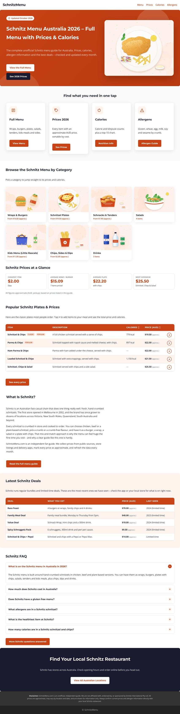
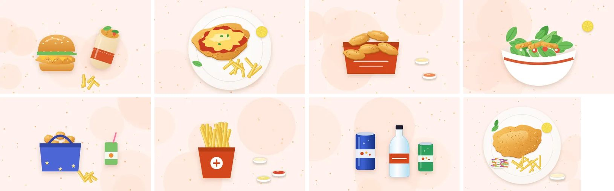

# SchnitzMenu.com: Astra + Elementor website

This is a ready-to-install build of **schnitzmenu.com** that follows the RK Mohsin Schnitz blueprint:

- an **Astra child theme** with custom HTML, CSS and JavaScript
- **12 pages built in Elementor** that you can edit with drag-and-drop
- a **one-click import** of the whole site



## What's in the folder

| Path | What it is |
|---|---|
| `dist/astra-child-schnitzmenu.zip` | The child theme. Upload it in **Appearance > Themes**. |
| `import/schnitzmenu-pages.xml` | All 12 pages with their Elementor layouts, Astra layout settings and RankMath titles and descriptions. |
| `dist/elementor-templates.zip` / `elementor/*.json` | The same layouts as Elementor templates, for **Templates > Import**. |
| `astra-child-schnitzmenu/data/menu.json` | All prices, calories, allergens, deals and FAQs. This is the one place you edit data. |
| `docs/competitor-analysis.md` | Live Google check of the competitors from October 2026. |
| `tools/` | Python scripts that regenerate the pages: `python3 tools/build.py`. |

### Pages

| URL | Page |
|---|---|
| `/` | Home: hero, 4 quick-link cards, popular plates table, "What is Schnitz?", deals, FAQ, call-to-action |
| `/schnitz-menu/` | Main guide: search, jump nav, every category table, calories, allergens, about, deals, 15 FAQs, Menu schema |
| `/schnitz-menu-prices/` | Full price list |
| `/schnitz-calories/` | Calorie chart and kJ table |
| `/schnitz-allergen-menu/` | Allergen matrix and gluten-free guide |
| `/schnitz-kids-menu/` | Kids menu |
| `/schnitz-coupons/` | Deals and bundles |
| `/about/`, `/contact/`, `/privacy-policy/`, `/disclaimer/`, `/dmca/` | Pages AdSense requires |

### Images (all original, all optimised)



- **8 original food illustrations**: a hero plate, plus wraps & burgers, plates, tenders, salads, kids meals, chips & dips, and drinks. They're drawn for this site, so there are no copyright or trademark problems (no Schnitz photos or logos).
- **WebP format, 3–21 KB each.** The blueprint's target is under 100 KB. Each image comes in two sizes with `srcset`, so phones download the small one. Every image has a fixed width and height (no layout jumping) and lazy loading. The home-page hero is preloaded so it appears first.
- **7 social-share cards** (1200×630 JPG), one per main page, so WhatsApp, Facebook and X show a branded preview automatically.
- **Pinterest pin** (1000×1500), **site icon / favicon / Apple touch icon**, and a **logo PNG** (`assets/img/logo-480.png`).
- **Appearance > Schnitz Menu Data > "Add illustrations to Media Library"** copies the images into your Media Library with alt text already filled in, so you can drag them into any Elementor Image widget.

### Speed and quality scores (Lighthouse, mobile, on the test install)

| Page | Performance | Accessibility | Best practices | SEO |
|---|---|---|---|---|
| Home | 92–93 | 100 | 96 | 100 |
| Schnitz Menu | 91 | 100 | 96 | 100 |

I measured these on a basic test server with no compression and no caching. On Hostinger with LiteSpeed Cache or W3 Total Cache turned on, they should be higher. Layout shift (CLS) is 0 on every page.

What makes it fast:
- **Fonts are self-hosted** (`assets/fonts`, ~19 KB each), so there are no Google Fonts requests. Astra's and Elementor's Google Fonts loading is switched off for these fonts.
- **CSS and JS are minified**: `schnitz.min.css` 15.7 KB and `schnitz.min.js` 4 KB.
- **jQuery loads in the footer** on the front end instead of blocking the page, and the WordPress emoji script is removed.
- Colours meet the WCAG AA contrast standard. The brand orange was darkened very slightly, from `#D4471A` to `#C74214`, to pass the contrast check.

### Features the competitors don't have

- **Live menu search**: type "parma" and only matching rows stay visible.
- **Sortable tables**: tap Calories or Price to sort.
- **Meal builder**: tap **+** on any item and a floating box shows the total price and calories. It's saved in the browser.
- **Calorie bar chart**, an **allergen colour matrix** and a **Print this menu** button.
- **Sticky jump navigation** that highlights the section you're reading.
- **FAQPage + Menu schema**, built automatically from the data.
- **Category picture grid** with "From $x" prices, **price-at-a-glance tiles** (cheapest, average wrap, average plate, most expensive), **breadcrumbs**, and a **"Checked by" trust box** on every guide page.
- **Disclaimer strip on every page**, plus a **sidebar** with guide links and order buttons. Your AdSense widget goes above the sidebar.
- No jQuery, no icon fonts, and no heavy images. Every icon and illustration is inline SVG, which keeps the site fast.

---

## Install (about 15 minutes)

You don't need to share your WordPress password with anyone. Do these steps yourself in `yoursite.com/wp-admin`.

1. **Install the parent theme and plugins**
   - Go to **Appearance > Themes > Add New**, search for **Astra**, then **Install**. You don't need to activate it.
   - Go to **Plugins > Add New** and install and activate **Elementor** and **Rank Math SEO**. Install **WordPress Importer** as well. If you go to **Tools > Import > WordPress**, it will ask you to install it.
2. **Install the child theme**
   - Go to **Appearance > Themes > Add New > Upload Theme**, choose `dist/astra-child-schnitzmenu.zip`, then **Install** and **Activate**.
   - Activating the theme also turns off Elementor's default blue colours and Roboto font, so the brand colours apply.
3. **Remove WordPress's default Privacy Policy draft**
   - Go to **Pages**, trash the draft "Privacy Policy" page, then click **Empty Trash**.
   - If you skip this step, the imported page ends up at `/privacy-policy-2/`.
   - Also delete "Sample Page".
4. **Import the pages**
   - Go to **Tools > Import > WordPress > Run Importer** and upload `import/schnitzmenu-pages.xml`.
   - Assign the posts to your user, then click **Submit**.
5. **Set the home page**
   - Go to **Settings > Reading**, choose **A static page**, and set **Homepage** to "Home".
   - Go to **Settings > Permalinks** and choose **Post name**.
6. **Build the menus**
   - Go to **Appearance > Menus** and create a **Primary** menu with Home, Schnitz Menu, Prices, Calories and Allergens. Assign it to the Astra **Primary Menu** location.
   - Create a **Footer** menu with About, Privacy Policy, Disclaimer, Contact and DMCA. Assign it to **Footer Legal Links**.
7. **Set up the Astra Customizer** (Appearance > Customize)
   - **Global > Colors**: set the accent/primary colour to `#C74214`.
   - **Site Identity > Site Icon**: upload `astra-child-schnitzmenu/assets/img/site-icon-512.png`. Until you do, the theme shows its own favicon.
   - **Header Builder**: logo on the left, menu on the right. Upload `astra-child-schnitzmenu/assets/img/logo-480.png` as the logo.
   - **Speed**: in Elementor, open **Settings > Features** and turn on **Optimized DOM Output**, **Improved Asset Loading** and **Improved CSS Loading**. In your cache plugin, turn on page caching, Gzip/Brotli compression and browser caching.
   - **Sidebar**: the guide pages already use a right sidebar. Your AdSense widget goes in **Appearance > Widgets > Main Sidebar**.
8. **Check every price.** Open **Appearance > Schnitz Menu Data** and follow the next section.

## Updating prices every month

Open **Appearance > Schnitz Menu Data** in WordPress. You don't need FTP or any code.

- Change the **Updated** label, for example to "November 2026". Every page badge updates automatically.
- Edit the JSON. Each item looks like this:
  `{ "name": "Parma & Chips", "desc": "...", "kcal": 897, "price": 22.50, "tags": ["popular"] }`
- Use `null` when you don't know a value. It shows as "Varies" for a price or "—" for calories.
- If you make a typo, the JSON is rejected and the old data stays live, so you can't break the site.
- Paste your **Menulog, Uber Eats and DoorDash affiliate links** here. The order buttons appear once you add a link.

## Editing with Elementor (drag and drop)

- Every page opens with **Edit with Elementor**. Headings, text, buttons, cards and colours are normal Elementor widgets: drag them, restyle them, or add new ones.
- The tables, charts, FAQ and so on are **Shortcode** widgets, so you can drag one anywhere. The full list is in `astra-child-schnitzmenu/inc/shortcodes.php`:

| Shortcode | Shows |
|---|---|
| `[sm_price_table cat='plates']` | Price table. Other categories: `wraps-burgers`, `tenders-schnacks`, `salads`, `kids`, `chips-dips`, `drinks`. Separate several with commas. |
| `[sm_jump_nav]` | Sticky jump links |
| `[sm_menu_search]` | Live search box |
| `[sm_calorie_chart top='10']` | Calorie bar chart |
| `[sm_nutrition_table]` | Calories and kJ table |
| `[sm_allergens]` | Allergen matrix |
| `[sm_faq set='main' limit='6']` | FAQ accordion with schema |
| `[sm_deals]` | Deals table |
| `[sm_order]` | Order buttons |
| `[sm_related pages='schnitz-menu,schnitz-calories']` | Related-page cards |
| `[sm_updated]` | "Updated October 2026" badge |
| `[sm_print]` | Print button |
| `[sm_menu_schema]` | Menu JSON-LD |
| `[sm_image name='cat-plates']` | Responsive illustration. Names: `hero-schnitzel-plate`, `cat-plates`, `cat-wraps-burgers`, `cat-tenders-schnacks`, `cat-salads`, `cat-kids`, `cat-chips-dips`, `cat-drinks` |
| `[sm_category_grid]` | Category picture cards |
| `[sm_price_stats]` | Price-at-a-glance tiles |
| `[sm_author]` | "Checked by" trust box |
| `[sm_breadcrumbs]` | Breadcrumbs (uses Rank Math's when active) |

- These CSS classes are available in **Advanced > CSS Classes** on any container: `sm-hero` (orange gradient banner), `sm-band` (light orange box), `sm-band-dark` (navy), `sm-card` (white card with shadow).

## Before you publish: read this

- **Verify the data.** Prices come from public sources: Frugal Feeds (Oct 2026), Uber Eats and DoorDash listings, and QSR Media. Calories come from FatSecret AU. These sources sometimes disagree. Unknown values are left as `null` rather than guessed. Check them against your local store, then update `menu.json`.
- **Item descriptions** for some wraps (The Swiss, The Hawaiian, The Aussie, OMG!) are short generic descriptions written by us. Confirm the actual fillings.
- **Allergens.** Only what the official chart confirms is marked red or green. Everything else is "Check in store" (yellow). Keep it that way unless you've checked the official chart yourself.
- **Contact email.** The pages use `hello@schnitzmenu.com`. Create that mailbox, or change it in the Contact, Privacy and DMCA pages. To add a form, drop a **WPForms** widget onto the Contact page.
- **Trademark.** Your blueprint warns that a bare `schnitzmenu.com` domain carries trademark risk. The site says "unofficial" in the hero, on every page footer and on the Disclaimer page, and it doesn't use the Schnitz logo. Keep it that way.

## Rebuilding after editing page content or images

```bash
python3 tools/images.py      # redraw the illustrations, social cards and icons (needs Node + Playwright)
node tools/minify.js         # minify CSS/JS (needs the terser + csso npm packages)
python3 tools/build.py       # regenerate import/, elementor/ and dist/
```

The page text is in `tools/pages.py`, and the illustrations are in `tools/art.py`.

## Updating an existing install

If you already imported version 1.0:
1. Upload the new `dist/astra-child-schnitzmenu.zip` in **Appearance > Themes > Add New > Upload** and choose **Replace current with uploaded**.
2. Trash the 12 old pages, empty the trash, then import `import/schnitzmenu-pages.xml` again.

If you've already edited pages in Elementor, import the changed ones one at a time instead: go to **Templates > Saved Templates > Import**, choose a file from `elementor/`, and insert it into the page.
